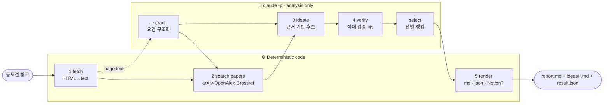

<div align="center">

# 🛠️ contest-idea-forge

**Turn a single contest link into demo-ready, paper-backed, adversarially-verified project ideas.**
공모전 링크 하나로 — **데모 가능 · 논문 근거 · 적대 검증**을 거친 아이디어를 뽑아냅니다.

[](LICENSE)
[](pyproject.toml)
[](SKILL.md)
[](../../actions)
[](../../pulls)

</div>

---

> **Design principle / 설계 원칙** — *Code automates, Claude only analyzes.*
> 오케스트레이션·논문 수집·중복제거·렌더링은 전부 결정적 파이썬 코드가 처리하고,
> 판단이 필요한 4단계(**추출 · 도출 · 검증 · 선별**)만 헤드리스 `claude -p`에 위임합니다.

## ✨ Why this exists / 왜 만들었나

평범한 "아이디어 brainstorm"은 세 가지 함정에 빠집니다. 이 도구는 그걸 파이프라인으로 막습니다:

| 함정 (failure mode) | 방어 (how it's caught) |
| --- | --- |
| 🪞 이미 존재하는 제품의 답습 | `verify` 단계가 상용 제품·OSS·선행 논문을 검색해 `prior_art` 판정 |
| 🎭 그럴싸하지만 내용이 엉터리 | `technical_soundness` 적대 검토 — 모순/과장은 `kill` |
| 📰 검증 안 된 최신 동향 인용 | 아이디어는 **실재 논문**(arXiv·OpenAlex·Crossref)에만 근거, 인용 실재성 재확인 |

추가로 모든 아이디어는 **팀 규모 · 데모 기간** 안에서 만들 수 있는지(`feasibility`) 점검합니다.

## 🧭 How it works / 동작 방식



| # | Step | Who | What |
| --- | --- | --- | --- |
| 1 | `fetch_contest` | code (+1 분석콜) | 페이지 다운로드·정제 → Claude가 요건 구조화 |
| 2 | `search_papers` | **code** | 분야 키워드로 arXiv·OpenAlex·Crossref 수집·중복제거 (옵션: Claude 웹검색으로 국내 논문 보완) |
| 3 | `ideate` | **Claude** | 제약(팀·데모·필수데이터) 하에서 근거 기반 후보 N개 |
| 4 | `verify` | **Claude** | 후보별 적대 검증(답습/타당성/인용/실현성), 병렬 |
| 5 | `select` + `render` | Claude + **code** | 생존 아이디어 선별·랭킹 → Markdown/JSON 산출 |

## 🚀 Quickstart / 빠른 시작

**Requirements**: Python 3.9+ and an authenticated [Claude Code](https://claude.com/claude-code) CLI (`claude` on `PATH`; run `claude login` once).

```bash
git clone https://github.com/pokochy/contest-idea-forge
cd contest-idea-forge
pip install -r requirements.txt        # only PyYAML

# Link in, ideas out:
python -m contest_idea_forge.run --url "https://<contest link>"
```

Common options / 자주 쓰는 옵션:

```bash
python -m contest_idea_forge.run --url "<link>" \
  --candidates 6 --n-ideas 3 \         # 후보 6 → 검증 → 최종 3
  --team-size 3 --demo-period "약 2개월" \
  --korean-search \                    # 국내(KCI/DBpia) 논문 보완 (Claude 웹검색 1콜)
  --no-nonmajor                        # 비전공자 포함 제약 해제
```

`--no-verify` 빠른 1패스 · `--notion` Notion 페이지 내보내기 · `--analysis-model opus` 모델 지정.

## 📦 Output / 산출물

```
out/<contest-slug>/
├── report.md          # 개요 · 선정 아이디어 표 · 선정 논리 · 폐기 후보 · 참고 논문
├── ideas/
│   ├── idea_01.md      # 문제·접근·데이터·데모범위·역할분담·근거논문·적대검증
│   └── idea_02.md …
├── contest.json        # 구조화된 공모전 요건
├── papers.json         # 수집된 논문
└── result.json         # 전체 원자료 (candidates / verdicts / selected)
```

## ⚙️ Options / 옵션

| Flag | Default | 설명 |
| --- | --- | --- |
| `--url` | — | 공모전 페이지 링크 (required) |
| `--candidates` | 6 | 도출할 후보 수 |
| `--n-ideas` | 3 | 최종 선별 수 |
| `--team-size` | 4 | 팀 인원 상한(실현성 판단) |
| `--demo-period` | `약 2개월` | 데모 완성 기간 |
| `--no-nonmajor` | off | 비전공자 포함 제약 해제 |
| `--no-verify` | off | 검증/선별 생략(빠른 1패스) |
| `--korean-search` | off | Claude 웹검색으로 국내 논문 보완 |
| `--from-year` | 2023 | 논문 최소 연도 |
| `--notion` | off | Notion 페이지 생성(`NOTION_TOKEN`,`NOTION_PARENT_PAGE_ID`) |
| `--analysis-model` / `--extract-model` | CLI default | 분석 모델 override |

설정 파일로도 기본값을 둘 수 있습니다 — `config.example.yaml` → `config.yaml` 복사 후 `--config config.yaml`.

## 🧩 Use it as a Claude Code skill / 스킬로 쓰기

Drop the repo into your skills directory so Claude triggers it automatically when you paste a contest link:

```bash
git clone https://github.com/pokochy/contest-idea-forge ~/.claude/skills/contest-idea-forge
```

`SKILL.md`의 description이 "공모전 링크 + 아이디어 요청"에 매칭되어, Claude가 직접 아이디어를 쓰는 대신 이 파이프라인을 호출합니다.

## 🔌 Backends / 백엔드

- **Default**: headless `claude -p` (uses your Claude Code subscription — no extra key).
- **Anthropic API fallback**: `claude_client.py`를 API 호출로 바꾸면 Claude Code 없이도 동작합니다 (키 필요). PR 환영.

## ⚠️ Limitations / 한계

- JS로만 렌더되거나 로그인이 필요한 페이지는 추출이 빌 수 있습니다 → `out/<slug>/contest.json`을 보정 후 재실행.
- 영어 학술 API는 국내(KCI) 커버리지가 약합니다 → `--korean-search` 권장.
- 논문 실재성은 검증하지만, **출품 전 핵심 인용·데이터 확보 가능성은 직접 1차 확인**하세요(도구가 권고로 명시).
- Notion 내보내기는 v0.1에서 표를 문단으로 단순 변환합니다(Markdown 리포트가 정본).

## 🤝 Contributing

Issues·PRs welcome — 새 논문 소스, API 백엔드, 다른 공모전 사이트 파서, 출력 포맷 등.

## License

[MIT](LICENSE) © pokochy

<div align="center"><sub>Built with Claude Code · code automates, Claude analyzes.</sub></div>
