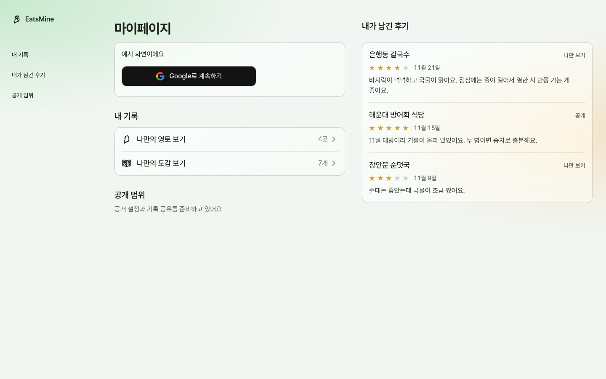
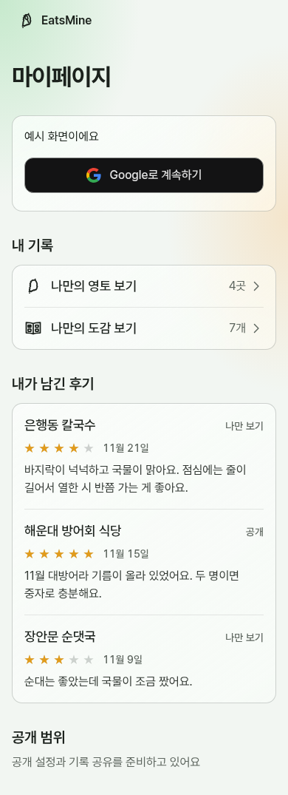
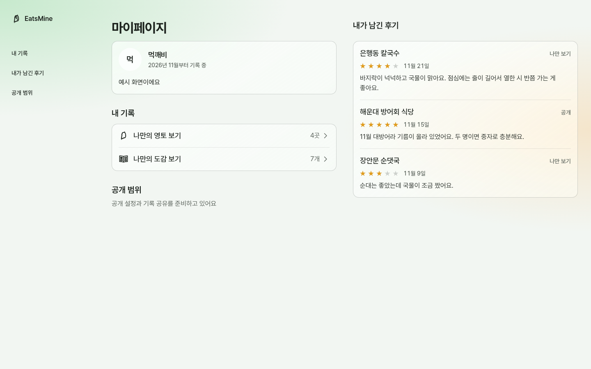
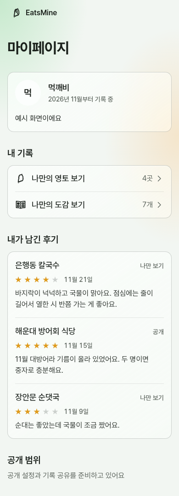

# EatsMine

지역과 음식을 탐색하고 나만의 방문 기록을 모으는 서비스입니다.

## 마이페이지 미리보기

마이페이지의 반응형 화면입니다. 화면의 프로필, 방문 지역, 음식과 후기는 **예시 데이터**입니다. Google 로그인, 실제 기록 조회, 공개 설정과 공유는 아직 연결되지 않았습니다.

| 비로그인 · PC | 비로그인 · 모바일 |
| --- | --- |
|  |  |

| 로그인 후 예시 · PC | 로그인 후 예시 · 모바일 |
| --- | --- |
|  |  |

로그인 후 예시 화면은 개발 환경의 `/my/preview`에서 확인할 수 있으며, 운영 빌드에는 노출되지 않습니다. 현재 홈은 기본 화면이고 도감은 아직 연결되지 않아 `/dictionary`로 이동하면 404가 표시됩니다.

## 로컬 실행

Node.js 22 이상이 필요합니다.

```bash
npm install
npm run dev:web
```

웹은 `http://localhost:3000`에서 실행됩니다. API도 함께 실행하려면 `npm run dev`를 사용합니다.
