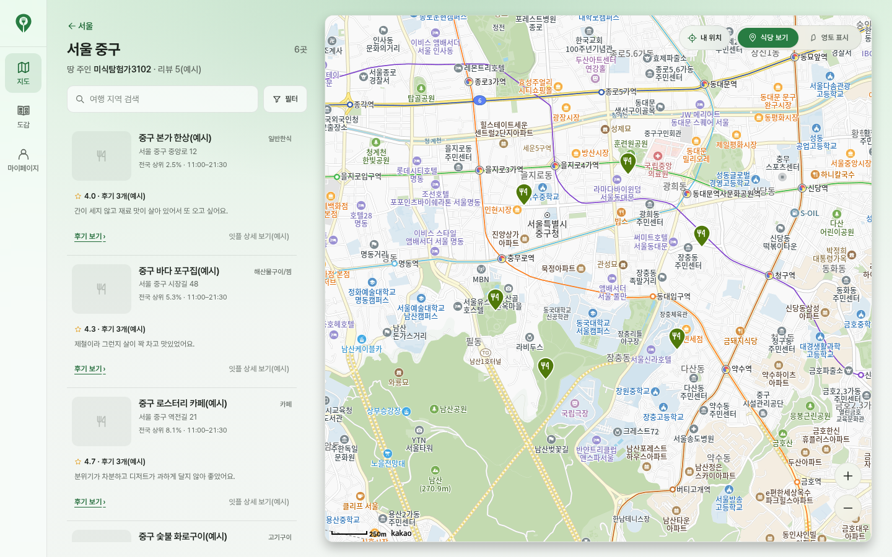
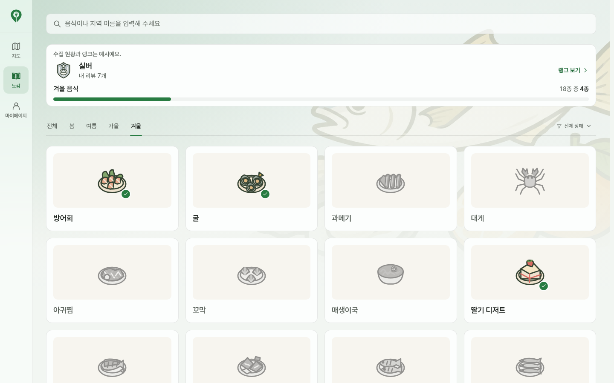
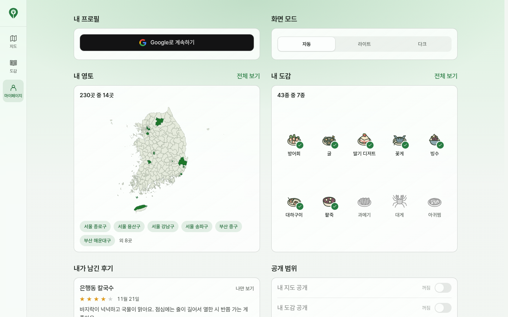

<div align="center">


# EatsMine

지역과 제철 음식을 골라 맛집을 찾고, 다녀온 곳을 내 영토와 도감으로 모으는 웹 서비스


[](https://eatsmine.vercel.app/)

</div>

## 화면

<table>
<tr>
<th width="33%">지도</th>
<th width="33%">도감</th>
<th width="33%">마이페이지</th>
</tr>
<tr>
<td></td>
<td></td>
<td></td>
</tr>
</table>

## 구성

| 폴더 | 내용 |
| --- | --- |
| `apps/web` | Next.js 웹 (지도, 도감, 마이페이지) |
| `apps/api` | NestJS API, Drizzle, Supabase Postgres |
| `supabase` | DB 마이그레이션 |

## 실행

Node.js 22 이상. `apps/web/.env.example`, `apps/api/.env.example`을 참고해 환경변수를 채웁니다.

```bash
npm install
npm run dev      # 웹 :3000, API :4000
```
